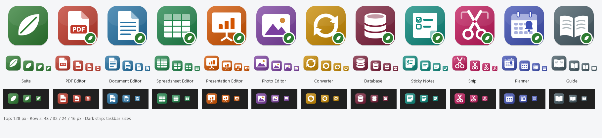

# EthicalApp



**Free desktop apps for Windows that are actually free – no subscriptions, no watermarks, no accounts, no ads,
no tracking.** Made by [CraftingBenchGames](https://craftingbenchgames.com/).

**Download:** <https://ethicalapp.org> · **Free online tools** (run in your browser, nothing uploaded):
<https://ethicalapp.org/tools>

| App | What it does |
|-----|--------------|
| **EthicalApp** (launcher) | One window with all your installed apps; open or drop any file and it goes to the right app |
| **Ethical PDF Editor** | View, edit text, annotate, fill forms, sign, merge/split PDFs |
| **Ethical Document Editor** | Write documents; opens and saves Word `.docx` files |
| **Ethical Spreadsheet Editor** | Spreadsheets with 143 formulas & charts; opens and saves Excel `.xlsx` files |
| **Ethical Presentation Editor** | Slide decks & slideshows; opens and saves PowerPoint `.pptx` files |
| **Ethical Photo Editor** | Layer-based photo editor; opens and saves Photoshop `.psd` with layers, plus PNG/JPG/WebP… |
| **Ethical Converter** | Convert & compress audio, video, pictures, documents; trim videos; combine; zip/unzip |
| **Ethical Database** | Databases: tables, forms, queries, relationships, reports |
| **Ethical Sticky Notes** | Notes and to-do lists that stay on your desktop |
| **Ethical Snip** | Screenshots (area / window / full screen / free-form) you can mark up, pixelate, crop |
| **Ethical Planner** | Reminders and calendar events that pop up on time, with Done/Snooze |

Press **F1** in any app for the searchable offline user guide. Optional: connect the apps to **Claude** (AI
assistant) so it can use them for you – the installer offers this.

## Install
Download the installer from <https://ethicalapp.org> – no admin password needed, choose which apps you want,
uninstall any time from Settings → Apps. Windows may show "Windows protected your PC" for a new program: click
**More info → Run anyway**. You can check the download is genuine with the SHA-256 fingerprint shown on the site.

## Build the installer from source
1. Install **Python 3.14** and **Inno Setup 6** (`winget install JRSoftware.InnoSetup`).
2. In this folder:
   ```
   python -m venv .venv
   .venv\Scripts\python -m pip install -r requirements.txt
   .venv\Scripts\python installer\build.py
   ```
3. The installer appears in `dist\EthicalApp-Setup-<version>.exe`.

GitHub Actions builds the same installer from this repository (`.github/workflows/build.yml`).

## Licence
**AGPL-3.0** (`LICENSE`). EthicalApp is built on open-source components (Qt/PySide6, PyMuPDF, FFmpeg, python-docx,
openpyxl, python-pptx, Pillow and more) – their licences are in `licenses/` and listed in each installation's
`licenses` folder. Not affiliated with Microsoft or Adobe.


